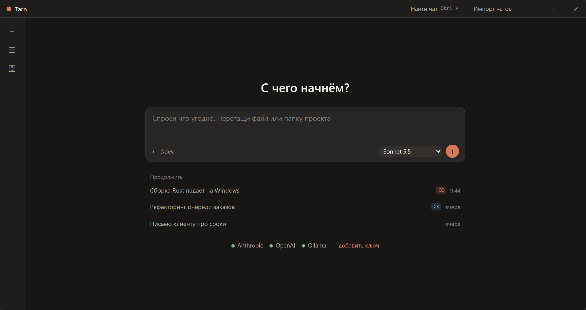
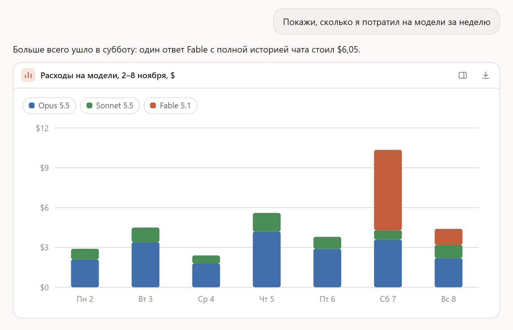

# Tarn

Моё приложение для работы с нейросетями на Windows. Работает по своим ключам: Anthropic, OpenAI, Google, OpenRouter, DeepSeek, Mistral, xAI, Groq, локальные модели через Ollama. Всё хранится на компьютере, своего сервера нет.



Писал под себя: надоело держать пять вкладок с разными чатами и гадать, во сколько обошёлся ответ. Теперь всё в одном окне, и у каждого ответа видна цена.

Чаты из Claude Code и Codex подтягиваются в общую историю, разговор можно продолжить другой моделью. Голосовой ввод работает без интернета на Parakeet, текст можно править прямо во время диктовки. Модели можно дать папку проекта: она читает и правит файлы, запускает команды. Что ей можно делать без спроса, решают режимы доступа, а неудачные правки откатываются.

Справа открываются панели с терминалом, браузером, правками в файлах, планом и артефактами. Ещё модель умеет вставлять в ответ живые виджеты: график расходов, тест, мини-страницу, симулятор Telegram-бота.



Подключаются MCP-серверы и скиллы. Длинные чаты сжимаются сами, чтобы не платить каждый раз за всю историю.

## Запуск

Нужны Node.js 20+ и Rust.

```
npm install
npm run tauri dev
```

Сборка: `npm run tauri build`.

Tauri 2, Rust, SolidJS.
